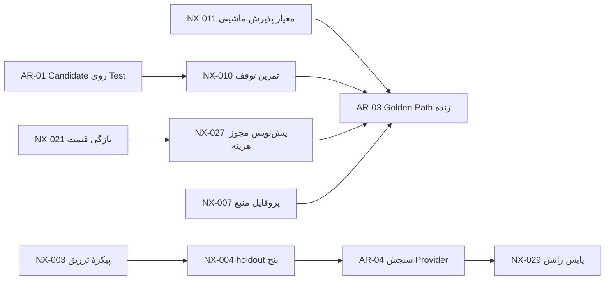

# پنجاه گام جدید توسعهٔ Hero — NX-001 تا NX-050

> Document ID: `HERO-ROADMAP-NEXT-50-STEPS-20261013`
> Canonical path: `docs/roadmap/NEXT-50-STEPS-20261013.md`
> Title: پنجاه گام جدید توسعهٔ Hero — NX-001 تا NX-050
> Type: roadmap
> Scope: hero
> Status: proposed
> Version: 1.1.0
> Owner: hero-product
> Review cadence: per-change
> Supersedes: none
> Superseded by: none

## ۱. هدف و مرز

این سند نتیجهٔ ایده‌پردازی ۲۰۲۶-۱۰-۱۳ برای ادامهٔ توسعهٔ Hero است: ۵۰ گام جدید با شناسهٔ `NX-001` تا `NX-050`، در پنج مسیر. هدف این است که پس از ساخت لایه‌های حاکمیت، Back Office و عامل‌های آفلاین، قدم بعدی روشن، ریزشده، قابل‌سنجش و بدون ادعای اغراق‌آمیز باشد.

- وضعیت پایهٔ گام‌ها `proposed` است. این سند و کارت‌های آن **مجوز اجرا نیستند**؛ فقط گام‌هایی که در Snapshot مجوز نسخه‌دار آمده‌اند (بخش ۱۳) شروع شده‌اند.
- طبق AGENTS.md (قواعد ۸، ۱۱ و ۱۲) هر گام پیش از Dispatch باید در یک Snapshot مجوز نسخه‌دار، با Step ID و نسخهٔ سند منطبق ثبت شود و Global Stop خاموش باشد. نسخهٔ 1.0.0 چنین Snapshotی نمی‌ساخت؛ صدور آن با مالک است. Snapshot دستهٔ اول (بخش ۱۳) از دستور مالک در گفتگو ثبت شد.
- هیچ Provider زنده، هزینهٔ بیرونی، Secret، Production، پیام بیرونی یا Notion/GitHub write در این بسته لمس نشده است.
- شماره‌گذاری `NX-*` مستقل از `BO-001..170` و `AR-01..11` است و شمارندهٔ «۱۴۲ از ۱۷۰» را تغییر نمی‌دهد.

## ۲. نقطهٔ شروع: آنچه در مخزن بررسی شد

| یافته | منبع بررسی | اثر روی این برنامه |
|---|---|---|
| ۱۴۲ از ۱۷۰ گام Back Office `verified`؛ ۲۶ `gated`، ۱ `owner_pending`، ۱ `deferred` | `config/backoffice/delivery-audit-v1.0.json` | گام‌های NX جایگزین BO نیستند؛ بسته‌شدن gatedها همچنان AR-11 است |
| از ۸۱ نیازمندی فقط ۱۰ `implemented` و ۷۱ `partial` است | `config/backoffice/requirement-trace-v1.0.json` | از جمله NX-006، NX-031، NX-033، NX-034 و NX-049 مستقیم یک نیازمندی partial را هدف می‌گیرند |
| ۱۱ کار باز AR-01..AR-11؛ Golden Path هرگز زنده اجرا نشده | [AGENT-READINESS-GOLDEN-PATH-20261009](AGENT-READINESS-GOLDEN-PATH-20261009.md) | NX-010، NX-011، NX-021، NX-027 پیش‌نیازهای AR-03 را آماده می‌کنند |
| Agent Tool Gateway، Hero-Bench (۳۰ تکلیف، ۷ دسته)، Run Estimate و OTLP exporter ساخته شده ولی به Runtime وصل نیستند | `packages/domain/src/agent-tool-gateway.mjs`، `config/bench/hero-bench-v1.json`، ADR-0017 | مسیر A و C دور همین‌ها لایهٔ اعتماد و هزینه می‌سازند |
| `server.mjs` ۴٬۵۵۱ خط است و ۲۴ migration SQL دارد | `apps/control-plane/src/server.mjs`، `packages/adapters/migrations/` | NX-041..NX-043 |
| فقط ۲ از ۱۴ فایل نما از `createTranslator` استفاده می‌کنند؛ پالت Ctrl+K فقط ناوبری ثابت را فیلتر می‌کند | `packages/contracts/src/ui-locale.mjs`، `apps/control-plane/src/hero-shell.mjs` | NX-031، NX-032 |
| `estimateRun` برای قیمت منقضی فقط هشدار می‌دهد؛ `assembleContext` فقط سقف تعداد آیتم دارد | `packages/domain/src/run-estimate.mjs`، `packages/domain/src/ai-orchestration.mjs` | NX-021، NX-025 |
| restore روی پایگاه disposable با checksum آزموده شده؛ restore روی Clean Linux واقعی blocker است | `tools/audit/backup-restore.mjs`، README | NX-047 |

## ۳. روش ایده‌پردازی

1. **استخراج شکاف از چهار منبع:** فهرست کارهای باز AR، نیازمندی‌های `partial` در requirement-trace، بخش «آنچه ادعا نمی‌شود» در سند Agent Readiness، و خواندن مستقیم کد.
2. **فیلتر:** گام باید (الف) تکراری یکی از AR/BO نباشد یا صراحتاً زیربنای آن باشد، (ب) معیار پذیرش قابل‌آزمون داشته باشد، (پ) fail-closed باشد و «ناشناخته» را «سالم» نکند، (ت) به اندازهٔ یک برش کاری کوچک شود، (ث) گیت تأیید روشن داشته باشد.
3. **راستی‌آزمایی ادعاهای فنی:** هر جملهٔ «در کد فعلی X وجود ندارد» پیش از نوشتن با جست‌وجو یا خواندن فایل سنجیده شد.
4. **اصلاح حین کار:** این بررسی چهار ایدهٔ اولیه را عوض کرد. «پالت فرمان با نرمال‌سازی فارسی» و «انگلیسی‌سازی UI» از قبل (به‌صورت محدود) وجود دارند؛ پس NX-032 و NX-031 به شکاف واقعی (جست‌وجوی فراتر از ناوبری؛ پوشش دوزبانه در ۱۲ نمای دیگر) بازتعریف شدند. ادعای «قیمت منقضی بررسی نمی‌شود» به «فقط هشدار می‌دهد و مقایسهٔ سقف را مسدود نمی‌کند» اصلاح شد (NX-021). و ادعای «تاریخ جلالی نیست» به «نمایش UI به رفتار ضمنی `fa-IR` تکیه دارد و کتابخانهٔ صریح نیست» اصلاح شد (NX-016).
5. **آنچه انجام نشد:** تحقیق وبی یا بنچ‌مارک بیرونی انجام نشد. این برنامه از تحلیل مخزن می‌آید و هیچ ادعای بازار یا رقابتی ندارد؛ عددهای بیرونی لازم برای هر گام (مثلاً قابلیت‌های رسمی مدل‌ها در NX-030) باید هنگام اجرا از منبع رسمی راستی‌آزمایی شوند.

## ۴. پنج مسیر

| مسیر | موضوع | گام‌ها | کارت‌ها |
|---|---|---|---|
| A | اعتماد به اجرای عامل‌ها | `NX-001` تا `NX-010` | [HERO-SPEC-NX-TRACK-A](../specs/NX-TRACK-A-AGENT-EXECUTION-TRUST-v1.0.md) |
| B | کارخانهٔ محصول و کیفیت | `NX-011` تا `NX-020` | [HERO-SPEC-NX-TRACK-B](../specs/NX-TRACK-B-PRODUCT-FACTORY-QUALITY-v1.0.md) |
| C | اقتصاد و هوشمندی مدل | `NX-021` تا `NX-030` | [HERO-SPEC-NX-TRACK-C](../specs/NX-TRACK-C-COST-MODEL-INTELLIGENCE-v1.0.md) |
| D | تجربهٔ فارسی‌محور و همکاری | `NX-031` تا `NX-040` | [HERO-SPEC-NX-TRACK-D](../specs/NX-TRACK-D-EXPERIENCE-COLLABORATION-v1.0.md) |
| E | پلتفرم، قابلیت اتکا و زنجیرهٔ تأمین | `NX-041` تا `NX-050` | [HERO-SPEC-NX-TRACK-E](../specs/NX-TRACK-E-PLATFORM-RELIABILITY-SUPPLY-CHAIN-v1.0.md) |

## ۵. فهرست ۵۰ گام

ستون‌ها: **موج** ترتیب پیشنهادی بر پایهٔ وابستگی است (نه تعهد زمانی)؛ **اولویت** P0 تا P2؛ **اندازه** S/M/L نسبی است؛ **گیت** کلاس تأیید است (بخش ۹). جزئیات هر گام در کارت مسیر مربوط آمده است.

| شناسه | گام | مسیر | موج | اولویت | اندازه | گیت | وابستگی |
|---|---|---|---|---|---|---|---|
| NX-001 | کنسول مجوز ابزار عامل | A | 2 | P1 | M | `test-runtime` | `NX-002`، `ADR-0017` |
| NX-002 | تأییدکنندهٔ یکپارچگی زنجیرهٔ Audit | A | 1 | P1 | S | `offline` | `ADR-0017` |
| NX-003 | پیکرهٔ تزریق دستور غیرمستقیم | A | 1 | P0 | M | `offline` | `ADR-0017` |
| NX-004 | بخش نگه‌داشته و محافظ آلودگی بنچ | A | 2 | P1 | M | `offline` | `NX-003` |
| NX-005 | ضبط‌کنندهٔ پرواز اجرا (Run Flight Recorder) | A | 3 | P1 | L | `offline` | `AR-02`، `NX-002` |
| NX-006 | قرنطینهٔ حافظهٔ آلوده و ردیابی منشأ | A | 1 | P1 | M | `offline` | `BO-MEM-003` |
| NX-007 | پروفایل‌های منبع Runner | A | 1 | P1 | M | `offline` | `ADR-0006` |
| NX-008 | شبیه‌ساز خروج شبکه پیش از Dispatch | A | 2 | P2 | S | `offline` | `BO-SEC-005`، `NX-007` |
| NX-009 | Checkpoint امضاشده با تأیید در Resume | A | 1 | P1 | S | `offline` | `ADR-0006` |
| NX-010 | تمرین دوره‌ای توقف اضطراری (Global Stop Drill) | A | 2 | P0 | M | `test-runtime` | `AR-01`، `ADR-0005` |
| NX-011 | کامپایلر معیار پذیرش | B | 1 | P0 | M | `offline` | — |
| NX-012 | امتیاز کامل‌بودن Intake | B | 2 | P1 | S | `offline` | `NX-011` |
| NX-013 | بستهٔ قالب‌های بازار فارسی | B | 3 | P2 | M | `offline` | `NX-011`، `NX-014` |
| NX-014 | بستهٔ پایهٔ امنیت محصول | B | 2 | P1 | M | `offline` | `NX-007` |
| NX-015 | کیت رابط RTL-first برای محصولات | B | 2 | P2 | M | `offline` | `NX-016` |
| NX-016 | جعبه‌ابزار محلی‌سازی فارسی (جلالی، ارقام، ارز، جست‌وجو) | B | 1 | P1 | S | `offline` | — |
| NX-017 | کارخانهٔ دادهٔ آزمون فارسی | B | 2 | P2 | S | `offline` | `NX-016`، `BO-PRD-003` |
| NX-018 | گیت مجوز و وابستگی محصول | B | 1 | P1 | M | `offline` | — |
| NX-019 | ارزیاب جامع «تعریف تمام‌شدن» محصول | B | 3 | P1 | M | `test-runtime` | `NX-011`، `NX-014`، `NX-018`، `NX-037` |
| NX-020 | baseline بصری ساختاری برای Back Office | B | 2 | P2 | M | `offline` | — |
| NX-021 | گیت تازگی قیمت‌ها (Price Freshness) | C | 1 | P0 | S | `offline` | — |
| NX-022 | گزارش کالیبراسیون برآورد | C | 3 | P1 | M | `test-runtime` | `AR-06`، `NX-021` |
| NX-023 | پیش‌بینی نرخ مصرف و تاریخ اتمام بودجه | C | 2 | P2 | S | `test-runtime` | `NX-021` |
| NX-024 | شبیه‌ساز «اگر مسیردهی عوض شود» | C | 3 | P2 | M | `offline` | `NX-021`، `NX-025`، `NX-030` |
| NX-025 | تخصیص‌دهندهٔ بودجهٔ توکن برای context | C | 1 | P1 | M | `offline` | — |
| NX-026 | سیاست Failover امن Provider | C | 2 | P1 | M | `offline` | `NX-030` |
| NX-027 | سازندهٔ پیش‌نویس مجوز هزینه | C | 2 | P0 | M | `offline` | `NX-021` |
| NX-028 | گردش‌کار جایگزینی مدل منسوخ | C | 2 | P2 | M | `test-runtime` | `NX-030`، `BO-AI-002` |
| NX-029 | پایشگر رانش کیفیت مدل | C | 4 | P2 | M | `gated-live` | `AR-04`، `NX-004`، `NX-030` |
| NX-030 | ماتریس قابلیت مدل‌ها | C | 1 | P2 | S | `offline` | — |
| NX-031 | گسترش دوزبانگی به همهٔ صفحات | D | 2 | P1 | L | `test-runtime` | `NX-016`، `BO-UX-001` |
| NX-032 | جست‌وجوی سراسری فراتر از ناوبری | D | 3 | P2 | M | `test-runtime` | `NX-016`، `NX-031` |
| NX-033 | توضیح‌دهندهٔ «چرا؟» برای هر وضعیت | D | 2 | P1 | M | `test-runtime` | `ADR-0005`، `BO-UX-003` |
| NX-034 | کارت‌های تأیید موبایل‌محور | D | 3 | P2 | M | `test-runtime` | `NX-033`، `BO-UX-002` |
| NX-035 | خلاصهٔ روزانهٔ مالک | D | 3 | P1 | M | `test-runtime` | `AR-05`، `NX-033` |
| NX-036 | چک‌لیست راه‌اندازی اولیهٔ هدایت‌شده | D | 3 | P2 | S | `test-runtime` | `NX-031` |
| NX-037 | گزارش انطباق دسترس‌پذیری (WCAG 2.2 AA) | D | 1 | P1 | M | `offline` | — |
| NX-038 | ترجیحات اعلان و ساعت سکوت | D | 2 | P2 | S | `test-runtime` | `BO-NTF-002` |
| NX-039 | دفتر تصمیم و پیش‌نویس ADR | D | 2 | P2 | S | `offline` | — |
| NX-040 | بازنگری Run و پیشنهاد درس‌آموخته | D | 4 | P2 | M | `test-runtime` | `NX-005`، `NX-006` |
| NX-041 | مانیفست اعلانی مسیرها | E | 2 | P1 | L | `offline` | — |
| NX-042 | تولید OpenAPI و کنترل رانش قرارداد | E | 3 | P2 | M | `offline` | `NX-041` |
| NX-043 | لینتر ایمنی Migration | E | 1 | P1 | S | `offline` | — |
| NX-044 | بودجهٔ کارایی و baseline هر Candidate | E | 3 | P2 | M | `test-runtime` | `AR-01` |
| NX-045 | تأیید منشأ و امضای Release پیش از Promote | E | 4 | P1 | M | `gated-live` | `BO-OUT-003` |
| NX-046 | آشکارساز رانش پیکربندی میزبان Test | E | 2 | P1 | M | `test-runtime` | `AR-01` |
| NX-047 | تمرین دوره‌ای Restore با اندازه‌گیری RPO/RTO | E | 4 | P1 | M | `gated-live` | `NX-046` |
| NX-048 | سیاست بودجهٔ خطا (Error Budget) | E | 4 | P2 | S | `test-runtime` | `NX-044`، `NX-033` |
| NX-049 | آزمون خاصیتی ایزولاسیون پروژه‌ها | E | 1 | P0 | L | `offline` | `BO-IAM-005` |
| NX-050 | بستهٔ شواهد انتشار (Release Evidence Pack) | E | 3 | P1 | M | `test-runtime` | `NX-046`، `AR-01` |

جمع‌بندی: اولویت P0 ۶ گام، P1 ۲۵ گام، P2 ۱۹ گام. گیت `offline` ۲۹ گام، `test-runtime` ۱۸ گام و `gated-live` ۳ گام.

## ۶. موج‌ها و ترتیب پیشنهادی

| موج | معنا | تعداد | گام‌ها |
|---|---|---|---|
| 1 | بنیان آفلاین: گام‌هایی که به هیچ گام NX دیگری وابسته نیستند و با `pnpm check` اثبات می‌شوند. | ۱۴ | NX-002، NX-003، NX-006، NX-007، NX-009، NX-011، NX-016، NX-018، NX-021، NX-025، NX-030، NX-037، NX-043، NX-049 |
| 2 | لایه‌های وابسته به موج ۱ و صفحه‌های Back Office که به Candidate Test نیاز دارند. | ۱۹ | NX-001، NX-004، NX-008، NX-010، NX-012، NX-014، NX-015، NX-017، NX-020، NX-023، NX-026، NX-027، NX-028، NX-031، NX-033، NX-038، NX-039، NX-041، NX-046 |
| 3 | گام‌های ترکیبی و گزارش‌هایی که به دادهٔ واقعی یا چند گام قبلی نیاز دارند. | ۱۲ | NX-005، NX-013، NX-019، NX-022، NX-024، NX-032، NX-034، NX-035، NX-036، NX-042، NX-044، NX-050 |
| 4 | گام‌های انتهایی: اتصال بیرونی (gated-live) و گام‌هایی که روی خروجی موج ۳ سوارند. | ۵ | NX-029، NX-040، NX-045، NX-047، NX-048 |

قاعدهٔ ماشینی: هر گام باید در موجی بعد از همهٔ وابستگی‌های NX خودش باشد (`WAVE_ORDER_VIOLATION`). این ترتیب پیشنهاد است؛ مالک می‌تواند با Snapshot مجوز، هر گام را زودتر یا دیرتر آزاد کند، به شرط برآورده‌شدن وابستگی‌ها.

## ۷. مسیر بحرانی تا اجرای زندهٔ Golden Path

پیش‌نیازهای هفت‌گانهٔ AR-03 در سند Agent Readiness (بخش ۶) فهرست شده‌اند. نگاشت آن‌ها به گام‌های این برنامه:

| پیش‌نیاز اجرای زنده | گام‌های کمک‌کننده | چه کسی تصمیم می‌گیرد |
|---|---|---|
| Global Stop خاموش و محیط فقط Test | — | مالک |
| مجوز هزینهٔ نسخه‌دار با سقف ≥ بدترین برآورد | NX-021 (قیمت تازه)، NX-027 (پیش‌نویس مجوز) | مالک (صدور) |
| مرجع امن کلید Provider در Secret Store | — | مالک |
| خط پایهٔ Hero-Bench با digest | NX-003، NX-004 (کیفیت بنچ)، AR-04 (اجرا) | مالک (هزینه) |
| معیارهای پذیرش قالب تأییدشده | NX-011 (کامپایل ماشینی) | مالک (تأیید) |
| تمرین توقف اضطراری با تاریخ ثبت‌شده | NX-010 | مالک (اجرا روی Test) |
| اجرا فقط در Runner ایزوله با خروجی redacted | NX-007، NX-009 | — |

هیچ‌کدام از این گام‌ها خودش اجرای زنده را باز نمی‌کند؛ آن‌ها فقط پیش‌نیازها را آماده و قابل‌سنجش می‌کنند.

## ۸. نگاشت به کارهای باز AR-01..AR-11

| کار باز | گام‌های مرتبط | نقش |
|---|---|---|
| AR-01 به‌روزرسانی Test با rc.45 | NX-010، NX-044، NX-046، NX-050 | اجرای واقعی این گام‌ها روی Candidate مستقر انجام می‌شود |
| AR-02 اتصال Gateway به Dispatch | NX-001، NX-002، NX-005 | UI مجوز، تأیید زنجیره و ضبط اجرا روی همان اتصال سوارند |
| AR-03 Golden Path زنده | NX-007، NX-010، NX-011، NX-021، NX-027 | آماده‌سازی پیش‌نیازها (بخش ۷) |
| AR-04 سنجش واقعی Providerها | NX-003، NX-004، NX-024، NX-029، NX-030 | کیفیت و پایش بنچ؛ اجرا همچنان به مجوز هزینه نیاز دارد |
| AR-05 Delivery Truth در Back Office | NX-002، NX-033، NX-035، NX-048 | فیلد یکپارچگی، توضیح وضعیت، خلاصهٔ روزانه، توصیهٔ بودجهٔ خطا |
| AR-06 endpoint برآورد و تاریخچه | NX-021، NX-022، NX-023 | تازگی قیمت، کالیبراسیون، پیش‌بینی مصرف |
| AR-07 اتصال OTLP | NX-005 | ردگیری redacted قابل‌صادرکردن پس از مجوز جدا |
| AR-08 تقسیم `server.mjs` | NX-041، NX-042 | مانیفست مسیرها پایهٔ تقسیم امن است |
| AR-09 تطبیق نام دسته‌های OWASP | NX-003 | پیکره روی همان نگاشت سوار می‌شود؛ تطبیق متن رسمی همچنان باز است |
| AR-10 ایمیل بازیابی، آنتی‌ویروس، import GitHub | — | عمداً پوشش داده نشد؛ اتصال بیرونی و مجوز جدا لازم دارند |
| AR-11 gatedهای BO-121..146 و BO-169 | NX-045، NX-046، NX-047 | شواهد عملیاتی کمکی؛ بستن gate با مالک است |

## ۹. گیت‌ها و مجوز

| کلاس گیت | تعریف | سقف وضعیت بدون شرط بیشتر |
|---|---|---|
| `offline` | کد، قرارداد، ابزار یا سند که با `pnpm check` (و در صورت نیاز `pnpm test:browser`) بدون میزبان Test، Provider یا اتصال بیرونی قابل اثبات است. | `verified` با Evidence همان commit |
| `test-runtime` | علاوه بر `pnpm check`، تا اجرای آزمون پذیرش روی Candidate مستقر در Test توسط مالک، حداکثر `source_complete` است و `verified` نمی‌شود. | `source_complete` تا آزمون پذیرش Test |
| `gated-live` | نیازمند اتصال بیرونی، Provider، Secret، هزینه یا مقصد واقعی است؛ بدون مجوز جداگانهٔ مالک اجرا نمی‌شود و فقط بخش آفلاین آن می‌تواند `source_complete` شود. | `source_complete` برای بخش آفلاین؛ `verified` فقط با Evidence اجرای مجاز |

مجوز یک گام یعنی: Snapshot نسخه‌دار با `stepId` و `documentVersion` منطبق با کارت، Global Stop خاموش، و (برای مرزهای حساس) مجوز جدا. عملیات حساس (Production، حذف داده، هزینهٔ بیرونی، تغییر Secret، پیام بیرونی، کار برگشت‌ناپذیر) هرگز با مجوز یک گام NX به‌صورت ضمنی باز نمی‌شوند. اگر مالک اختیار کامل را لغو کند، Dispatch جدید فوراً متوقف و رکورد مجوز نسخه‌دار می‌شود (AGENTS.md قاعدهٔ ۱۳).

## ۱۰. چرخهٔ وضعیت و تعریف Done

`proposed` ← `authorized` ← `in_progress` ← `source_complete` ← `verified`؛ و `dropped` برای گام منصرف‌شده (گام حذف نمی‌شود؛ شماره‌ها ثابت و پیوسته می‌مانند).

- `authorized`: Snapshot مجوز گام ثبت و معتبر است.
- `source_complete`: کد/سند/آزمون ساخته شده و `pnpm check` همان commit واقعاً سبز بوده؛ حداقل یک مسیر Evidence در رجیستری ثبت شده است.
- `verified`: گیت کارت (بخش ۹) با Evidence واقعی بسته شده؛ برای `test-runtime` و `gated-live` رکورد در `docs/evidence/` الزامی است.
- چکر `check:next-steps` وضعیت `source_complete`/`verified` را بدون Evidence رد می‌کند و تعداد کل را با `summary` مقایسه می‌کند تا بزرگ‌نمایی ممکن نباشد.

## ۱۱. ریسک‌ها، فرض‌ها و آنچه ادعا نمی‌شود

- **اندازه‌ها و موج‌ها برآوردند.** S/M/L نسبی است و زمان‌بندی تعهد نمی‌دهد.
- **فرض وابستگی به AR:** گام‌هایی که به AR-01/AR-02/AR-04/AR-05/AR-06 وابسته‌اند فقط پس از آن‌ها کامل می‌شوند؛ بخش آفلاین بسیاری از آن‌ها می‌تواند زودتر `source_complete` شود.
- **ریسک بزرگ‌شدن دامنه:** NX-031، NX-041 و NX-049 اندازهٔ L دارند و باید گروه‌به‌گروه با آزمون‌های موجود پیش بروند.
- **قابلیت مدل‌ها:** NX-030 به راستی‌آزمایی انسانی از مستندات رسمی نیاز دارد؛ عامل مقدار را حدس نمی‌زند و `unknown` می‌ماند.
- **ادعا نمی‌شود:** هیچ‌کدام از ۵۰ گام ساخته یا اجرا نشده؛ هیچ Evidence عملیاتی جدید ثبت نشده؛ تحقیق بازار انجام نشده؛ checker و آزمون‌ها فقط انسجام رجیستری و اسناد را می‌سنجند، نه درستی فنی ایده‌ها؛ و ثبت این برنامه در رجیستری ماشینی Delivery Truth (که به گام جدا و تأیید مالک نیاز دارد) انجام نشده است.

## ۱۲. کنترل خودکار و شواهد این بسته

فرمان‌ها:

    pnpm check:next-steps
    pnpm check:docs

`check:next-steps` در `pnpm check` اجرا می‌شود و این‌ها را fail می‌کند: شناسهٔ ناپیوسته یا تکراری؛ موج/اولویت/اندازه/گیت/وضعیت نامعتبر؛ وابستگی ناشناخته یا چرخه؛ ارجاع AR/ADR/BO/HERO که در مخزن وجود ندارد؛ نقض ترتیب موج؛ وضعیت بدون Evidence؛ `summary` ناهمخوان؛ کارت یا ردیف جدول که با رجیستری نخواند؛ و سند مسیر ثبت‌نشده در رجیستری اسناد.

### نتیجهٔ راستی‌آزمایی

اجرای `pnpm check` روی همین source در ۲۰۲۶-۱۰-۱۳ (پیش از commit): exit 0؛ `node --test` شامل ۷۲۹ آزمون با ۷۲۸ موفق، ۰ شکست و ۱ آزمون skip‌شدهٔ قبلی (پایهٔ پیش از این بسته ۷۱۹ آزمون بود و ۱۰ آزمون جدید `tests/next-steps.test.mjs` اضافه شد)؛ `Next-50 steps: PASS` با ۵۰ گام و ۵ مسیر؛ `Documentation check: PASS` با ۱۶۵ سند (پیش‌تر ۱۵۹؛ ۶ سند جدید)؛ `BUILD PASS` با ۳۹۵ ماژول و ۸۵ فایل JSON؛ بقیهٔ کنترل‌ها (حاکمیت، Back Office، Agentic security، Hero-Bench، قالب‌ها، Golden Path) بدون تغییر PASS ماندند.

این اجرا فقط محلی است. CI، Runtime Test و هر ادعای مربوط به اجرای گام‌های NX جداگانه و پس از ساخت آن‌ها اثبات می‌شود؛ هیچ Evidence عملیاتی جدیدی ثبت نشده است.

## ۱۳. تصمیم‌های لازم از مالک

1. تأیید یا اصلاح خود برنامه (مسیرها، اولویت‌ها، گام‌های حذف‌شدنی). تا این تأیید، سند `proposed` می‌ماند.
2. انتخاب موج یا زیرمجموعهٔ گام‌هایی که اول مجوز می‌گیرند. پیشنهاد: موج ۱ به‌ویژه NX-003، NX-011، NX-021 و NX-049 (P0).
3. ورودی‌های مالک که برخی کارت‌ها صراحتاً لازم دارند:

   - `NX-004` — محل امن نگهداری holdout خارج از Git
   - `NX-006` — سیاست بازیابی رکوردهای legacy
   - `NX-013` — انتخاب و اولویت قالب‌ها
   - `NX-018` — فهرست مجوزهای مجاز و ممنوع
   - `NX-028` — allow-list رسمی مدل‌ها
   - `NX-038` — مقدار پیش‌فرض ساعت سکوت
   - `NX-045` — سیاست rollback برای imageهای قدیمی بدون attestation

4. در صورت تمایل، گام جداگانه برای ثبت این برنامه در گراف رودمپ ماشینی و Delivery Truth (پس از تأیید).

## ۱۴. مسیر کارت‌ها

- [مسیر A — اعتماد به اجرای عامل‌ها](../specs/NX-TRACK-A-AGENT-EXECUTION-TRUST-v1.0.md)
- [مسیر B — کارخانهٔ محصول و کیفیت](../specs/NX-TRACK-B-PRODUCT-FACTORY-QUALITY-v1.0.md)
- [مسیر C — اقتصاد و هوشمندی مدل](../specs/NX-TRACK-C-COST-MODEL-INTELLIGENCE-v1.0.md)
- [مسیر D — تجربهٔ فارسی‌محور و همکاری](../specs/NX-TRACK-D-EXPERIENCE-COLLABORATION-v1.0.md)
- [مسیر E — پلتفرم، قابلیت اتکا و زنجیرهٔ تأمین](../specs/NX-TRACK-E-PLATFORM-RELIABILITY-SUPPLY-CHAIN-v1.0.md)

## ۱۳. پیشرفت اجرا — ۲۰۲۶-۱۰-۲۱

Snapshot مجوز `BATCH-NX-20261021-001` (`config/authorizations/nx-20261021-001.json`، نسخهٔ اسناد `1.1.0`) ۱۲ گام آفلاین موج ۱ را مجاز کرد: `NX-002`، `NX-003`، `NX-007`، `NX-009`، `NX-011`، `NX-016`، `NX-021`، `NX-025`، `NX-030`، `NX-037`، `NX-043`، `NX-049`. `NX-006` و `NX-018` به ورودی مالک نیاز دارند و مجاز نشدند.

هر ۱۲ گام `in_progress` است، نه `source_complete`: آزمون‌های خود گام‌ها سبزند (۱۱۶ آزمون جدید) اما `pnpm check` کامل به‌خاطر دو شکست غیرمرتبط (کاتالوگ قیمت آزمایشی منقضی‌شده) هنوز سبز نیست. جزئیات، شکست‌های غیرمرتبط و یافته‌های جانبی در [شواهد اجرا](../evidence/NX-WAVE1-OFFLINE-20261021.md) آمده است. هیچ گامی `verified` نشده است.

چکر `check:next-steps` اکنون برای هر گام غیر `proposed` وجود Snapshot فعال، منطبق با Step ID و نسخهٔ سند، با Global Stop خاموش و بدون عملیات حساس را می‌سنجد (قاعدهٔ ۱۱ AGENTS.md).

